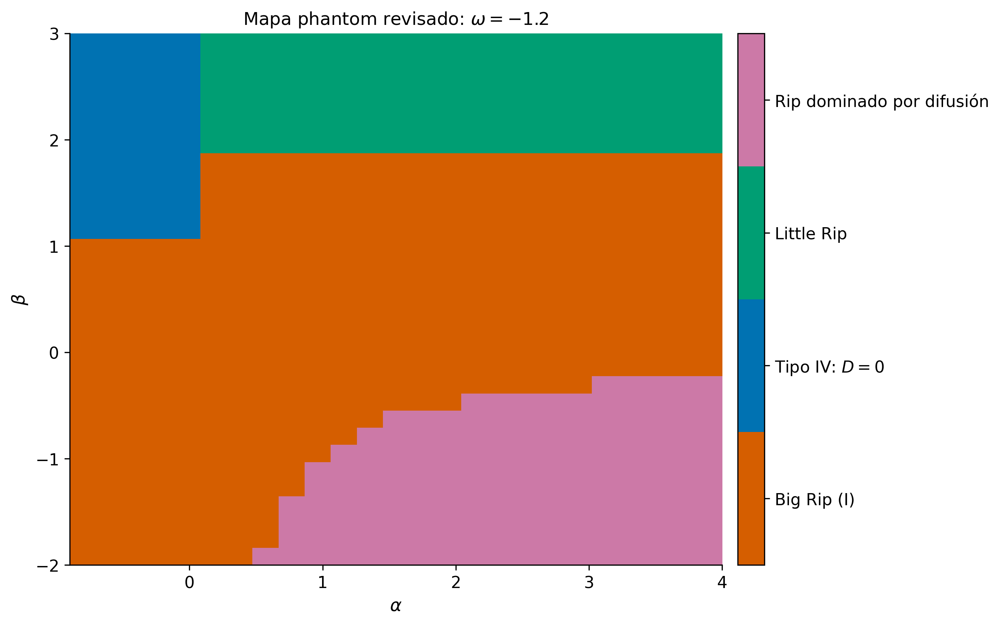
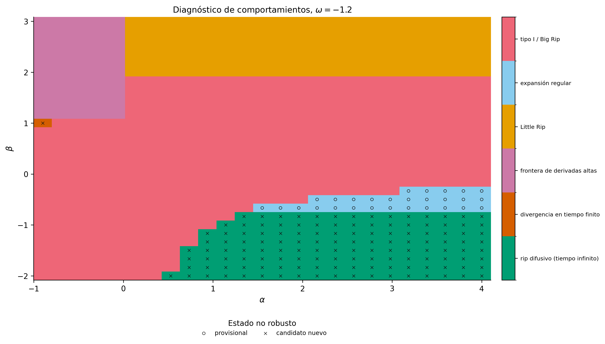

# Cosmo Singularities

Repositorio de análisis numérico y analítico de singularidades cosmológicas en modelos phantom y modelos barotrópicos con difusión. El proyecto separa la implementación física (`src/`), los experimentos reproducibles (`notebooks/`), los datos procesados y las figuras finales.

## Modelos incluidos

| Familia | Ecuaciones principales | Alcance |
|---|---|---|
| Phantom sin difusión | $p=-\rho-A\rho^\nu$, $Q=0$ | Límite RG, evolución de fondo y comparación con UG. |
| Phantom con difusión lineal | $p=-\rho-A\rho^\nu$, $Q=\alpha\rho$ | Regímenes futuros, tiempos singulares y visualizaciones analíticas. |
| Barotrópico con difusión de potencia | $p=\omega\rho$, $Q=\alpha\rho^\beta$ | Catálogo B1–F4, barrido de parámetros, fronteras y clasificación asintótica. |
| Cos–Cosh | $w(a)=w_a(a/a_0)\cos(a/a_0)-w_b(a/a_0)\cosh(a/a_0)-w_c$ | Evolución cosmológica y convergencia del tiempo crítico. |

Se emplean unidades naturales y las convenciones específicas se declaran al inicio de cada notebook y en las docstrings de `src/`.

## Estructura

```text
cosmo_singularities/
├── src/                 # Modelos, clasificadores y análisis
├── notebooks/           # Recorrido principal y apéndice UG–RG
├── data/processed/      # Datasets consolidados y reproducibles
├── results/             # Figuras finales y tablas exportadas
├── tests/               # Pruebas rápidas de integración
├── requirements.txt
└── README.md
```

Los inventarios detallados están en [`notebooks/README.md`](notebooks/README.md), [`data/README.md`](data/README.md) y [`results/README.md`](results/README.md).

## Instalación

Se recomienda Python 3.10 o superior. El proyecto no requiere un archivo `.env` ni credenciales externas.

```bash
cd cosmo_singularities
python -m venv .venv
source .venv/bin/activate
python -m pip install --upgrade pip
python -m pip install -r requirements.txt
```

En Windows, la activación equivalente es `.venv\Scripts\activate`.

## Recorrido recomendado

1. `01_modelo_cos_cosh.ipynb`: estudia la parametrización Cos–Cosh.
2. `02_validacion_modelo_barotropico.ipynb`: valida 16 casos representativos del catálogo barotrópico.
3. `03_espacio_parametros_barotropico.ipynb`: analiza el barrido completo de 5425 puntos.
4. `04_resultados_phantom_barotropico.ipynb`: presenta el subconjunto phantom revisado.
5. `05_graficos_phantom_ug.ipynb`: produce las figuras analíticas finales para gravedad unimodular.
6. `A01_comparacion_ug_vs_rg.ipynb`: apéndice comparativo entre gravedad unimodular (UG) y relatividad general (RG).

El notebook 03 carga por defecto el barrido consolidado incluido en el repositorio. Para recalcularlo desde cero hay que cambiar explícitamente `RUN_PARAMETER_SCAN = True`; esa operación es considerablemente más costosa que el recorrido de lectura.

Para abrir los notebooks:

```bash
jupyter lab
```

Para volver a ejecutarlos desde la raíz del repositorio:

```bash
for notebook in notebooks/*.ipynb; do
  jupyter nbconvert --to notebook --execute --inplace "$notebook"
done
```

## Uso desde Python

```python
import numpy as np

from src.models import PhantomQ0Model, PhantomQ0Params

params = PhantomQ0Params(A=0.1, nu=0.75, rho0=1.0)
model = PhantomQ0Model(params)
background = model.evaluate_background_t(np.linspace(0.0, 0.1, 100))

print(background[["t", "rho", "a", "H"]].head())
```

## Datos y reproducibilidad

El repositorio conserva únicamente los artefactos consolidados necesarios:

| Archivo | Filas | Columnas | Función |
|---|---:|---:|---|
| `phantom_results_revised.csv` | 2325 | 50 | Resultados phantom revisados del modelo barotrópico. |
| `parameter_scan_full.csv` | 5425 | 37 | Barrido completo del espacio de parámetros. |
| `scientific_table_full.csv` | 5425 | 20 | Selección compacta de variables científicas. |
| `representative_cases.csv` | 16 | 31 | Casos representativos B1–F4 y sus diagnósticos. |

Los seis notebooks se entregan ejecutados y sin errores almacenados. En conjunto contienen 72 celdas de código ejecutables. Las figuras se exportan en PDF para uso vectorial y, cuando facilita la vista previa en GitHub, también en PNG.

### Alcance de la clasificación phantom

Para $A>0$ y la rama expansiva futura,

$$
\dot{\rho}=C\rho^{\nu+1/2},\qquad C>0.
$$

Por eso la densidad solo diverge en tiempo finito si $\nu>1/2$. Los notebooks 05 y A01 aplican esta orientación temporal de forma explícita. Las utilidades históricas `classify_phantom_q0_by_nu`, `classify_phantom_qalpha_rho_by_nu` y los builders asociados se conservan sin cambios en `src/`, pero no se usan aquí para asignar un destino futuro cuando $\nu\leq1/2$: sus etiquetas tipo II/IV por intervalos alrededor de $\rho\to0$ no constituyen un clasificador del futuro expansivo y ciertos exponentes discretos requieren además un análisis de regularidad separado.

## Vista previa de resultados

| Mapa phantom revisado | Mapa barotrópico |
|---|---|
|  |  |

## Verificación

Ejecuta las pruebas rápidas con:

```bash
python -m unittest discover -s tests -v
```

La integración continua repite esta verificación en cada actualización del repositorio.

## Licencia y cita

La licencia y el formato de cita todavía deben ser definidos por el autor. No se concede una licencia de reutilización desde este repositorio hasta que se incorpore un archivo `LICENSE`; también se recomienda añadir `CITATION.cff` antes de la publicación definitiva.
